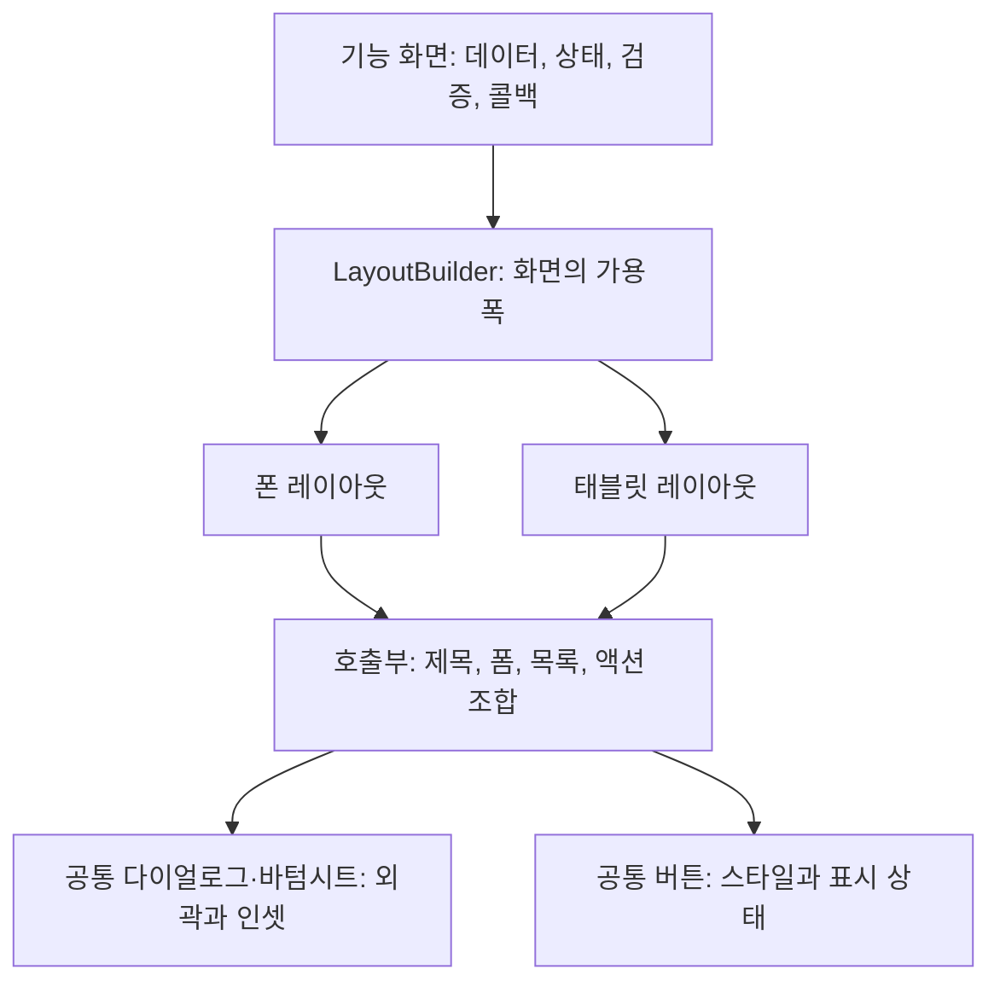

# Flutter 공통 UI와 태블릿 레이아웃

패키지형은 공용 코드를 UI 패키지에, 앱 내부형은 앱의 공용 UI 폴더에 둔다. 아래 이름은 예시이며 프로젝트에 대응 컴포넌트가 있으면 기존 API를 사용한다.

## 책임 분리



| 구성 | 공통 컴포넌트가 담당 | 호출부가 담당 |
|---|---|---|
| 다이얼로그 | 테마, 배경, 모서리, 기본 여백, 최대 폭, 콘텐츠가 넘칠 때의 스크롤 | 제목·본문·버튼 조합, 유효성 검사, 닫기·확인 결과 |
| 바텀시트 | 외곽과 상단 모서리, 너비, 드래그 핸들, 안전영역·키보드 대응 | 폼·목록·선택 상태, 제출·취소, 시트 목적에 맞는 닫기 옵션 |
| 버튼 | 강조 등급별 테마, 높이·터치 영역, 포커스, 비활성·로딩 표시 | 문구·아이콘·콜백, 활성 여부와 로딩 상태, 성공·실패 처리 |

## 공통 외곽과 호출부 구현 예시

아래 예시는 프로젝트의 DialogTheme, BottomSheetTheme, FilledButtonTheme를 공용 외곽에 적용한다. 시트의 간단한 본문은 이 예시처럼 공용 스크롤을 사용한다. 긴 목록·드래그 연동 시트는 목록의 ScrollController를 연결하고 스크롤 소유자를 하나로 둔 별도 변형으로 구현한다.

```dart
import 'package:flutter/material.dart';

Future<T?> showAppDialog<T>(
  BuildContext context, {
  required WidgetBuilder contentBuilder,
  bool barrierDismissible = true,
}) {
  return showDialog<T>(
    context: context,
    barrierDismissible: barrierDismissible,
    builder: (context) => Dialog(
      child: SingleChildScrollView(child: contentBuilder(context)),
    ),
  );
}

Future<T?> showAppSheet<T>(
  BuildContext context, {
  required WidgetBuilder contentBuilder,
  bool dismissible = true,
}) {
  return showModalBottomSheet<T>(
    context: context,
    isScrollControlled: true,
    useSafeArea: true,
    showDragHandle: true,
    isDismissible: dismissible,
    enableDrag: dismissible,
    builder: (context) => Padding(
      padding: EdgeInsets.only(bottom: MediaQuery.viewInsetsOf(context).bottom),
      child: SafeArea(
        top: false,
        child: SingleChildScrollView(child: contentBuilder(context)),
      ),
    ),
  );
}

class AppPrimaryButton extends StatelessWidget {
  const AppPrimaryButton({
    super.key,
    required this.label,
    required this.onPressed,
    this.loading = false,
  });

  final String label;
  final VoidCallback? onPressed;
  final bool loading;

  @override
  Widget build(BuildContext context) {
    return FilledButton(
      onPressed: loading ? null : onPressed,
      child: Row(
        mainAxisSize: MainAxisSize.min,
        children: [
          if (loading)
            const SizedBox.square(
              dimension: 16,
              child: CircularProgressIndicator(strokeWidth: 2),
            ),
          if (loading) const SizedBox(width: 8),
          Flexible(child: Text(label)),
        ],
      ),
    );
  }
}
```

호출부는 contentBuilder에 화면별 콘텐츠를 전달한다. 예를 들어 주소 선택 시트는 호출부가 주소 목록과 선택 UI를 만들고, 선택 시 시트의 context에서 Navigator.pop을 호출해 값을 돌려준다. 확인 다이얼로그의 확인·취소 버튼도 호출부가 조합한다. 버튼의 로딩 문구는 필요한 경우 호출부에서 현지화해 전달하고, 버튼 내부 치수는 프로젝트 토큰으로 옮긴다. 제출 중 닫기를 막아야 한다면 배경 탭·드래그 외에 시스템 뒤로가기도 해당 화면 정책에 맞춰 검증한다.

## 태블릿을 별도 레이아웃으로 관리

태블릿 지원으로 배치나 탐색이 달라지는 화면은 폰과 태블릿 레이아웃을 별도 파일로 둔다. 화면 진입점은 하나로 유지하고 LayoutBuilder의 maxWidth와 프로젝트 중단점으로 선택한다. 입력 컨트롤러와 기능 상태는 분기 위에서 소유하고 필요한 값과 콜백을 전달한다.

```text
features/address/
  screens/address_screen.dart
  widgets/address_phone_layout.dart
  widgets/address_tablet_layout.dart
  widgets/address_form.dart
```

예를 들어 폰은 목록 선택 후 상세 화면으로 이동하고, 태블릿은 목록·상세를 나란히 배치한다. 두 레이아웃 모두 주소 폼과 공용 버튼·시트를 사용한다. 여백이나 최대 폭만 달라지는 구간은 공통 위젯의 제약으로 관리한다. 태블릿 세로·가로와 분할 화면에서 폭이 바뀌어도 입력값과 주요 동작이 유지되는지 확인한다.
